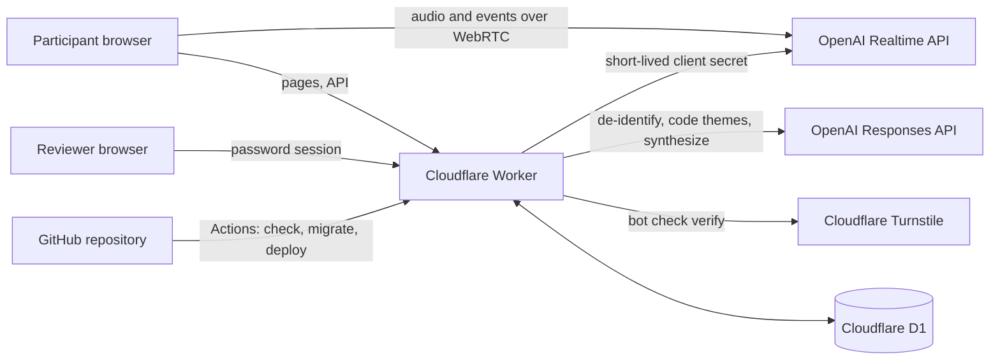

# Architecture

One serverless application, one database, two outside AI endpoints.

## Components

| Component | Location | Responsibility |
|---|---|---|
| Participant page | `src/app/Participant.tsx`, `src/app/realtime.ts` | Notice and consent, live conversation, captions, transcript review |
| Review page | `src/app/Dashboard.tsx` | Sign-in, themes, synthesis, responses, export |
| API | `src/worker/index.ts` | Routing, session start, submission, review endpoints, scheduled cleanup |
| Interviewer instructions | `src/worker/prompt.ts` | Built on the server for each conversation |
| De-identification and analysis | `src/worker/analysis.ts` | Redaction before storage, theme coding, synthesis |
| Access and abuse controls | `src/worker/security.ts` | Tokens, password session, bot check, IP hashing |
| Input and export helpers | `src/worker/format.ts` | Transcript cleaning, CSV cells |
| Campaigns | `campaigns/` | All unit-specific text and settings |
| Schema | `migrations/` | Applied automatically on deploy |
| Pipeline | `.github/workflows/` | Checks, production deploy, staging deploy |

## Data flow for one response

1. The participant reads the notice and ticks the AI disclosure. The page loads the bot check.
2. `POST /api/sessions` verifies consent, the bot check, and rate limits. The Worker asks OpenAI for a client secret that expires in two minutes, with the interviewer instructions attached, and returns it with a signed submit token.
3. The browser connects to OpenAI over WebRTC. Audio goes from the browser to OpenAI and back. It does not pass through the Worker and is not stored by this system.
4. The participant reviews and edits the transcript in the browser.
5. `POST /api/submissions` checks the token, removes identifying details, and only then writes the transcript to D1. If removal fails, nothing is written.
6. In the background the Worker codes the stored transcript into themes.
7. A daily job deletes transcripts past retention and rate-limit rows older than 48 hours.

## What is stored

| Table | Contents | Kept for |
|---|---|---|
| `submissions` | De-identified transcript, services selected, optional role, ease rating, date to the day, analysis | The campaign's `retentionDays` (STELAR: 365) |
| `sessions` | Random session id, campaign, time, daily-rotating salted IP hash, used flag | 48 hours |
| `login_attempts` | Daily-rotating salted IP hash, time | 48 hours |
| `syntheses` | Latest AI-written synthesis per campaign | Until regenerated |

`sessions` rows cannot be joined to `submissions` rows.

## Outside services

| Service | Data it receives | Terms to review |
|---|---|---|
| OpenAI Realtime API | Live audio and its transcription | API data controls: not used for training by default, safety logs up to 30 days |
| OpenAI Responses API | Transcript text, with `store: false` | Same |
| Cloudflare Workers, D1, Turnstile | Requests, stored rows, browser signals for the bot check | Cloudflare self-serve terms |
| GitHub | Source code only. No participant data | University GitHub organization |

## Environments

| Environment | Address | Database | Deployed by |
|---|---|---|---|
| Production | `stelar-listening.<account>.workers.dev` | `listening` | Push to `main` |
| Staging | `stelar-listening-staging.<account>.workers.dev` | `listening-staging` | "Deploy staging" workflow, run by hand |
| Local | `localhost:8787` | Local SQLite file | `npm run dev:api` |

## Secrets

Held as GitHub Actions secrets and copied to Cloudflare by the pipeline. None are in the repository.

`CLOUDFLARE_API_TOKEN`, `OPENAI_API_KEY`, `TURNSTILE_SECRET`, `DASHBOARD_PASSWORD`. `SESSION_SECRET` is generated once per environment by the pipeline and never leaves Cloudflare.
